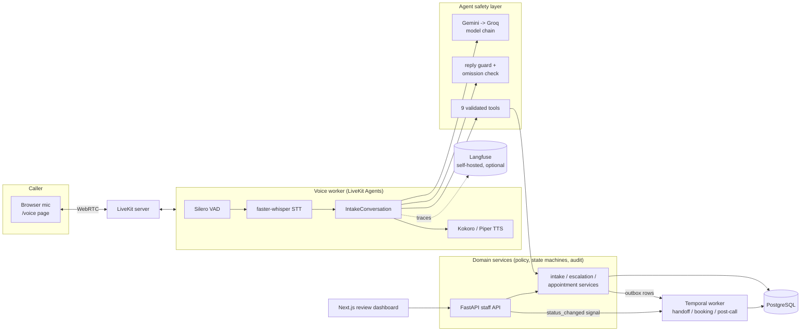
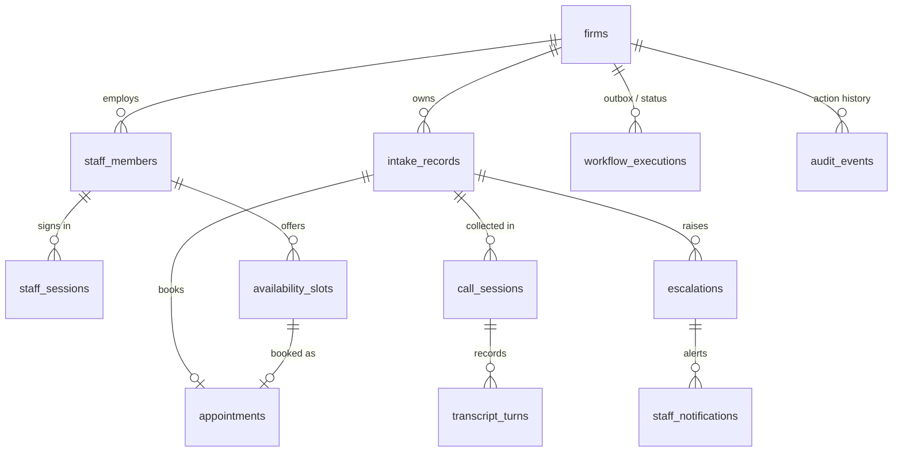

# Legal Intake & Case Handoff Voice Agent

A voice agent that handles the **administrative intake** of a (fictional) law firm. A caller talks
to it in the browser. It records structured facts with their provenance, applies the firm's
configured escalation rules, books a consultation from a real calendar, and hands the case to a
human through a durable, auditable workflow. Staff review everything in a dashboard.

> It automates the intake **workflow**, not legal judgment: the agent never gives advice, never
> promises representation, and never claims a booking, acceptance or save that the database does
> not confirm. Everything here (the firm "Northstar Legal", its staff and the callers) is
> fictional.

**At a glance**
- 45 labelled evaluation scenarios plus 9 voice scenarios.
- System track: 45/45 PASS, with 0 false booking confirmations, 0 duplicate bookings and every
  labelled critical escalation raised.
- Repeatable demo with video: [`docs/demo/DEMO.md`](docs/demo/DEMO.md).
- Engineering record: [`IMPLEMENTATION_PROGRESS.md`](IMPLEMENTATION_PROGRESS.md),
  [`CHANGE_LOG.md`](CHANGE_LOG.md). Security review: [`docs/SECURITY.md`](docs/SECURITY.md).

## Architecture



There are three separate concerns:
1. **Realtime conversation:** LiveKit worker plus the conversation loop.
2. **Validated business operations:** tools → domain services → PostgreSQL. Rules, authorization
   and escalation policy live in code and constraints, never in prompts.
3. **Durable execution:** Temporal workflows for handoff, booking and post-call follow-up,
   started through a transactional outbox.

| Path | What |
|---|---|
| `backend/app/domain/` | Business rules: provenance, state machines, escalation policy, booking, audit, auth |
| `backend/app/tools/`, `backend/app/agent/` | Tool executor (strict schemas), LLM adapters + fallback chain, reply guard, omission check |
| `backend/app/voice/` | STT/TTS/VAD adapters, voice session wiring |
| `backend/app/workflows/` | Temporal workflows, activities, outbox dispatcher, fault injection |
| `backend/app/api/` | Staff API (session auth, firm-scoped) |
| `backend/app/evaluation/` | Scenario runner, scripted model, checks, metrics, audio track |
| `frontend/` | Next.js + TypeScript review dashboard |
| `fixtures/scenarios/` | Labelled evaluation dataset |

## Local setup (Windows, PowerShell)

Prerequisites: Docker Desktop, Python 3.13 and Node 22. The voice GPU path is optional and tested
on an NVIDIA RTX 3050 Ti with 4 GB.

```powershell
docker compose up -d postgres livekit temporal
py -3.13 -m venv .venv
.\.venv\Scripts\python -m pip install -e "backend[dev]"
copy .env.example .env      # add GEMINI_API_KEY / GROQ_API_KEY; set DEMO_STAFF_PASSWORD (10+ chars)
.\.venv\Scripts\alembic -c backend/alembic.ini upgrade head
.\.venv\Scripts\python scripts/seed_demo_data.py
.\.venv\Scripts\python scripts/download_voice_models.py
.\.venv\Scripts\python scripts/enable_gpu.py                   # optional; re-run after pip installs
cd frontend; npm install; npm run build; cd ..
```

Run (one terminal each):

```powershell
.\.venv\Scripts\python scripts/temporal_worker.py              # workflows + outbox dispatcher
.\.venv\Scripts\python scripts/voice_worker.py start           # voice agent
cd backend; ..\.venv\Scripts\python -m uvicorn app.main:app --host 127.0.0.1 --port 8000
cd frontend; npm run start                                     # dashboard on http://127.0.0.1:3000
```

- Talk to the agent at **http://127.0.0.1:8000/voice** (allow the microphone).
- Review at **http://127.0.0.1:3000**: firm `northstar-legal`, e.g.
  `sana.kapoor@northstar-legal.example` (intake coordinator), password = `DEMO_STAFF_PASSWORD`.
- No microphone? `scripts/text_chat.py` runs the same agent in the terminal.
- **Tracing (optional):** run
  `docker compose -f infra/langfuse/docker-compose.yml --env-file infra/langfuse/.env up -d`
  (copy `infra/langfuse/.env.example` first), set `LANGFUSE_ENABLED=true` and the project keys
  in `.env`, then open http://localhost:3100. Every caller turn becomes a trace with model calls
  (tokens, latency, failovers), tool calls and guardrail blocks
  ([screenshot](docs/evidence/phase8/langfuse/langfuse_trace_detail.png)).

All commands, including the checks, are in [`CLAUDE.md` §12](CLAUDE.md).

## Database schema



- **`intake_records.fields`** stores, per question, `{value, status, note, source, updated_at,
  history}`. The status is one of `MISSING`, `REPORTED_BY_CALLER`, `CONFIRMED_BY_CALLER`,
  `DECLINED_BY_CALLER`, `PENDING_HUMAN_REVIEW` or `VERIFIED_BY_SYSTEM` (staff only).
- **State machines:**
  - Intake: `IN_PROGRESS → INCOMPLETE | PENDING_REVIEW → CLOSED`.
  - Escalation: `PENDING → ACCEPTED | FAILED | RESOLVED`; a FAILED handoff can never become
    ACCEPTED.
- **Database-level safeguards:** at most one booked appointment per slot and per intake (partial
  unique indexes), and one open escalation per intake and rule.
- **Tenancy:** every child row carries `firm_id` with a composite foreign key.

There are six Alembic migrations in `backend/alembic/versions/`, and `alembic check` reports no
drift.

## Sample conversations

[`docs/demo/DEMO.md`](docs/demo/DEMO.md) shows three complete conversations with every tool call,
the resulting database rows and Temporal's own event history:
1. a normal intake with a booked consultation;
2. an urgent deadline that triggers the firm's rule and a reviewer handoff;
3. a calendar that times out *after* the booking committed, recovered with a state check and no
   double booking.

It ends with a dashboard walkthrough video. Regenerate it with
`.\.venv\Scripts\python -u scripts/record_demo.py`.

## Scenario dataset

[`fixtures/scenarios/transcript_scenarios.json`](fixtures/scenarios/transcript_scenarios.json)
holds 45 labelled scenarios covering every case in the blueprint:

| Group | Count | Scenarios |
|---|---|---|
| Core intake | 18 | normal (5), urgent deadline (6, incl. a negative case), ambiguous date (3), missing phone (2), unsupported category (2) |
| Caller behaviour | 9 | refusal (3), legal-advice requests (3), interruptions and corrections (3) |
| Failures and recovery | 13 | calendar timeout (2), duplicate booking (2), disconnects (3), review-queue outage (2), LLM outage (2), database outage (2) |
| Adversarial model | 5 | false booking or acceptance claims, forbidden status, unoffered slot, unjustified escalation, edits after finalize |

Each scenario has caller turns, expected fields with statuses, escalations, booking count, intake
and session status, forbidden phrases, expected tool errors and handoff expectations. Nine are
labelled critical.

[`audio_scenarios.json`](fixtures/scenarios/audio_scenarios.json) adds 9 voice calls: 8
synthesized voices, 1.35× speed, 15 dB noise, mid-sentence pauses and barge-in.

## Evaluation results

One command: `.\.venv\Scripts\python -u scripts/run_evaluations.py --track system|live|audio|all`.

| Track | What it proves | Latest result |
|---|---|---|
| **system** (scripted model, real tools/DB/Temporal, injected faults) | System guarantees | **45/45 PASS**. False booking confirmations reaching the caller: **0**. Duplicate booking rate: **0.0**. Critical escalation recall: **1.0** (9/9). Recovery success: **1.0**. Handoff integrity: **1.0**. |
| **live** (Gemini → Groq, 29 scenarios) | Model quality | **26 PASS, 3 FAIL**. Field accuracy **0.972**. Critical escalation recall **1.0** (6/6). False booking confirmations **0**. Duplicates **0**. 10 omission nudges caught unsaved facts. |
| **audio** (LiveKit WebRTC, 9 synthesized callers) | Speech pipeline | **5/9 PASS**. Caller WER **0.084**. Agent-speech WER **0.033**. Response latency p50 **2.42 s** / p95 **2.88 s**. Barge-in 1/1. The 4 FAILs are speech-recognition misses on digits and names. |

The three live FAILs are genuine model deviations: a city not saved, a refusal stored as text, and
a legal question stored without its value. Negative controls (a disabled guard, disabled
escalation rules, wrong expectations) **fail** as they must, so a green run is meaningful. The reports are in `docs/evidence/phase6/` and
`docs/evidence/phase8/`.

## Reproducible walkthrough (definition of done)

| # | Step | How |
|---|---|---|
| 1–4 | Start the app, talk through the microphone, describe an enquiry, watch the fields fill | `/voice` page; the agent saves each fact as it is said (dashboard → Intakes) |
| 5 | Provenance labels | Intake detail: "Reported by caller (unverified)", "Verified by staff", … |
| 6 | Configured escalation in the review queue | Say a deadline within 3 days → URGENT `imminent_deadline` in the escalation queue |
| 7 | Book a consultation, verify it in PostgreSQL | Ask for a consultation; `select * from appointments` / Bookings page |
| 8 | Incomplete answer or disconnect | Hang up mid-call → session `DISCONNECTED`, intake `INCOMPLETE`, post-call follow-up |
| 9 | Calendar timeout and safe recovery | `scripts/record_demo.py` scene 3, or `CALENDAR_FAULT_INJECTION=timeout_after_commit:1` on the Temporal worker |
| 10 | Evaluation suite | `scripts/run_evaluations.py --track system` |
| 11 | Action history | Intake detail → Action history (agent and staff actions in commit order) |

## Known limitations

- **Live models are mostly but not always right** (26/29). Misses so far are provenance details
  (the deterministic safety layer covers deadlines, phones, emails, refusals and legal
  questions). Free-tier quotas limit how often the live track can run; exhaustion counts as
  SKIPPED, never PASS.
- **Speech recognition on phone numbers:** Whisper `base.en` misheard a phone number in 3 of 9
  voice calls. Implausible lengths are now rejected and re-asked (firm-configurable digit counts),
  which caught 2 of the 3. The third was misheard with the right length (10 digits); it would be
  saved, marked *reported by caller (unverified)*, so staff verify contact details.
- **4 GB GPUs:** Kokoro TTS together with Whisper saturated GPU memory under consecutive calls.
  `TTS_ENGINE=auto` now uses Piper below 6 GB of VRAM; Kokoro is used on larger GPUs.
- **Local demo only:** the voice token endpoint is unauthenticated, there is no TLS, Temporal and
  LiveKit run in dev mode, and staff auth is demo-grade. See
  [`docs/SECURITY.md`](docs/SECURITY.md) for the full list.
- **English only.** Hindi/Hinglish have not been tested.
