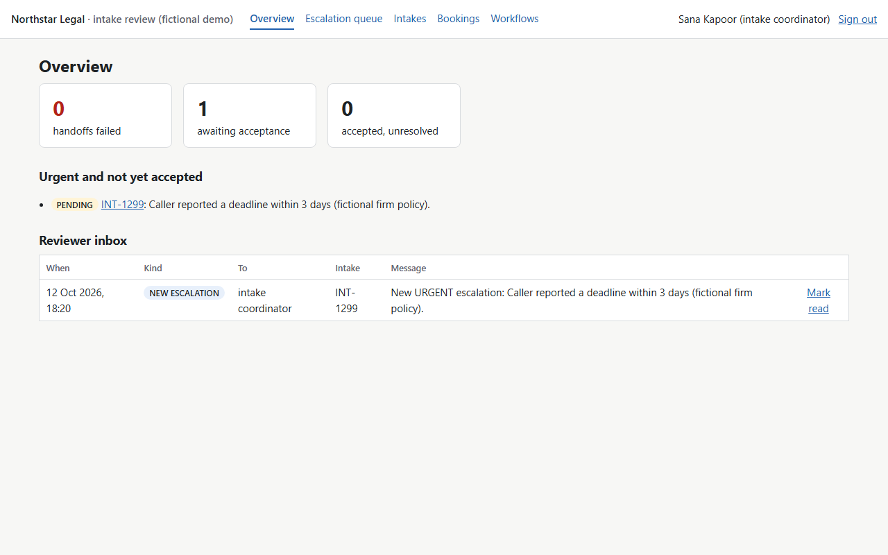
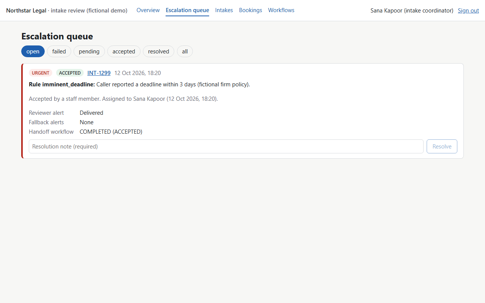
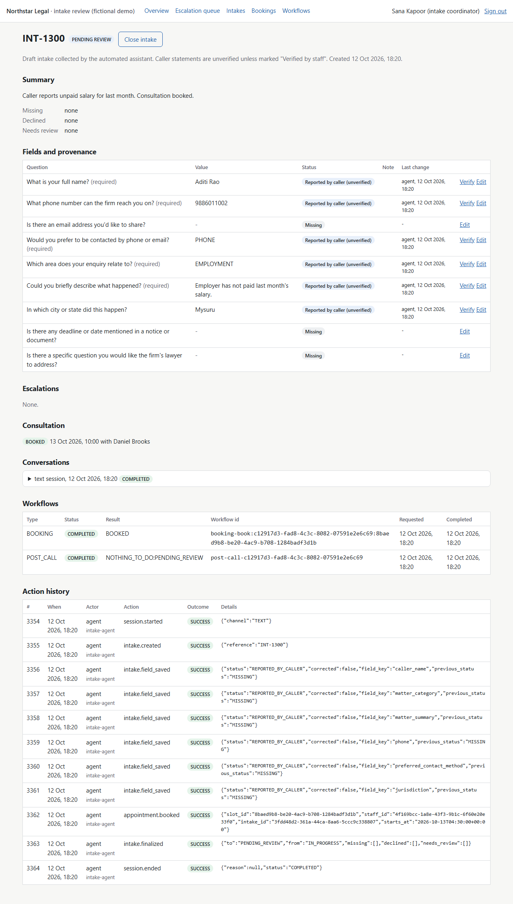

# Demo: Legal Intake & Case Handoff (fictional data)

Recorded 20261012T125025Z by `scripts/record_demo.py` (run it again to reproduce).

Everything below the model is the real system: validated tools, PostgreSQL, Temporal workers, the staff API and the Next.js dashboard. The model is the deterministic scripted model from the evaluation dataset (`fixtures/scenarios`), so this demo needs no API quota and replays identically; live-model behaviour is measured separately (Phase 6 live track). People, firm and numbers are invented.

**Result: PASS** - 7/7 checks.

## 1. Normal intake with a booked consultation

Scenario `N01_employment_booking`. Complete employment intake with a consultation booked.

> **Assistant:** Hello, thank you for contacting Northstar Legal. I'm the firm's virtual intake assistant. I can collect some initial information and help arrange a callback or consultation, but I can't give legal advice. This conversation is transcribed so the firm's team can review your enquiry. May I ask you a few questions?

> **Caller:** Hi, my name is Ananya Kulkarni. My employer terminated me without paying my final month's salary or notice pay.
>
> `create_draft_intake()` → intake_reference: INT-1298
> `save_intake_answer(field_key='caller_name', status='REPORTED_BY_CALLER', value='Ananya Kulkarni')` → saved as REPORTED_BY_CALLER
> `save_intake_answer(field_key='matter_category', status='REPORTED_BY_CALLER', value='EMPLOYMENT')` → saved as REPORTED_BY_CALLER
> `save_intake_answer(field_key='matter_summary', status='REPORTED_BY_CALLER', value="Terminated without payment of final month's salary or notice pay.")` → saved as REPORTED_BY_CALLER
>
> **Assistant:** Thank you. What phone number can the firm reach you on?

> **Caller:** You can reach me on 98200 11223. Phone calls are best. I'm in Mumbai.
>
> `save_intake_answer(field_key='phone', status='REPORTED_BY_CALLER', value='9820011223')` → saved as REPORTED_BY_CALLER
> `save_intake_answer(field_key='preferred_contact_method', status='REPORTED_BY_CALLER', value='PHONE')` → saved as REPORTED_BY_CALLER
> `save_intake_answer(field_key='jurisdiction', status='REPORTED_BY_CALLER', value='Mumbai')` → saved as REPORTED_BY_CALLER
>
> **Assistant:** Thank you. Is there any deadline or date mentioned in a notice or document?

> **Caller:** There is no deadline or notice. I'd like to book a consultation please.
>
> `check_appointment_availability()` → 3 real slots offered
>
> **Assistant:** I have a few consultation times available with the firm's lawyers. Which one suits you?

> **Caller:** The first one, please.
>
> `book_consultation(slot_id='7407a4ab-b4f0-4081-8e4b-88e44cf6e39d')` → verified booking: Tuesday 13 October 2026, 10:00 IST with Aarav Mehta
>
> **Assistant:** Your consultation is booked for the time you chose. Is there anything else to note?

> **Caller:** No, that's everything. Thank you.
>
> `finalize_intake_summary(summary='Caller reports termination without final salary or notice pay. Consultation booked.')` → intake_reference: INT-1298
>
> **Assistant:** Thank you. The firm's team will review your enquiry and contact you. Goodbye.

**Database afterwards**

- Intake INT-1298: `PENDING_REVIEW`; session `COMPLETED`
- Fields: phone = 9820011223 (`REPORTED_BY_CALLER`); caller_name = Ananya Kulkarni (`REPORTED_BY_CALLER`); jurisdiction = Mumbai (`REPORTED_BY_CALLER`); matter_summary = Terminated without payment of final month's salary or notice pay. (`REPORTED_BY_CALLER`); matter_category = EMPLOYMENT (`REPORTED_BY_CALLER`); preferred_contact_method = PHONE (`REPORTED_BY_CALLER`)
- Escalations: none
- Booked appointments: 1 (2026-10-13T04:30:00+00:00)
- Workflows: BOOKING `COMPLETED` BOOKED; POST_CALL `COMPLETED` NOTHING_TO_DO:PENDING_REVIEW

## 2. Urgent deadline: configured escalation and reviewer handoff

Scenario `U03_vacate_by_tomorrow`. Landlord notice to vacate by tomorrow.

> **Assistant:** Hello, thank you for contacting Northstar Legal. I'm the firm's virtual intake assistant. I can collect some initial information and help arrange a callback or consultation, but I can't give legal advice. This conversation is transcribed so the firm's team can review your enquiry. May I ask you a few questions?

> **Caller:** This is Imran Sheikh. My landlord gave me a notice to vacate the flat by tomorrow evening or he'll change the locks.
>
> `create_draft_intake()` → intake_reference: INT-1299
> `save_intake_answer(field_key='caller_name', status='REPORTED_BY_CALLER', value='Imran Sheikh')` → saved as REPORTED_BY_CALLER
> `save_intake_answer(field_key='matter_category', status='REPORTED_BY_CALLER', value='PROPERTY')` → saved as REPORTED_BY_CALLER
> `save_intake_answer(field_key='matter_summary', status='REPORTED_BY_CALLER', value='Landlord served notice to vacate the flat and threatened to change the locks.')` → saved as REPORTED_BY_CALLER
> `save_intake_answer(field_key='reported_deadline', status='REPORTED_BY_CALLER', value='2026-10-13')` → saved as REPORTED_BY_CALLER; escalation: imminent_deadline
>
> **Assistant:** I've noted that date and flagged your enquiry as urgent for the firm's team. What phone number can they reach you on?

> **Caller:** Call me on 97000 12345. I'm in Lucknow.
>
> `save_intake_answer(field_key='phone', status='REPORTED_BY_CALLER', value='9700012345')` → saved as REPORTED_BY_CALLER; escalation: imminent_deadline
> `save_intake_answer(field_key='preferred_contact_method', status='REPORTED_BY_CALLER', value='PHONE')` → saved as REPORTED_BY_CALLER; escalation: imminent_deadline
> `save_intake_answer(field_key='jurisdiction', status='REPORTED_BY_CALLER', value='Lucknow')` → saved as REPORTED_BY_CALLER; escalation: imminent_deadline
>
> **Assistant:** Thank you. Is there anything else you'd like the firm to know?

> **Caller:** No, nothing else.
>
> `finalize_intake_summary(summary='Caller reports a landlord notice to vacate the flat by tomorrow.')` → intake_reference: INT-1299
>
> **Assistant:** Thank you. The firm's team will review your enquiry and contact you. Goodbye.

**Database afterwards**

- Intake INT-1299: `PENDING_REVIEW`; session `COMPLETED`
- Fields: phone = 9700012345 (`REPORTED_BY_CALLER`); caller_name = Imran Sheikh (`REPORTED_BY_CALLER`); jurisdiction = Lucknow (`REPORTED_BY_CALLER`); matter_summary = Landlord served notice to vacate the flat and threatened to change the locks. (`REPORTED_BY_CALLER`); matter_category = PROPERTY (`REPORTED_BY_CALLER`); reported_deadline = 2026-10-13 (`REPORTED_BY_CALLER`); preferred_contact_method = PHONE (`REPORTED_BY_CALLER`)
- Escalations: imminent_deadline URGENT `PENDING`
- Booked appointments: 0
- Workflows: POST_CALL `COMPLETED` NOTHING_TO_DO:PENDING_REVIEW; HANDOFF `STARTED`

## 3. Calendar failure and safe recovery

Scenario `C01_calendar_timeout_after_commit`. The calendar times out after the booking committed: the workflow checks state before retrying - exactly one appointment, confirmed.

> **Assistant:** Hello, thank you for contacting Northstar Legal. I'm the firm's virtual intake assistant. I can collect some initial information and help arrange a callback or consultation, but I can't give legal advice. This conversation is transcribed so the firm's team can review your enquiry. May I ask you a few questions?

> **Caller:** Hello, I'm Aditi Rao. My employer has not paid my salary for last month.
>
> `create_draft_intake()` → intake_reference: INT-1300
> `save_intake_answer(field_key='caller_name', status='REPORTED_BY_CALLER', value='Aditi Rao')` → saved as REPORTED_BY_CALLER
> `save_intake_answer(field_key='matter_category', status='REPORTED_BY_CALLER', value='EMPLOYMENT')` → saved as REPORTED_BY_CALLER
> `save_intake_answer(field_key='matter_summary', status='REPORTED_BY_CALLER', value="Employer has not paid last month's salary.")` → saved as REPORTED_BY_CALLER
>
> **Assistant:** Thank you. What phone number can the firm reach you on?

> **Caller:** My number is 98860 11002, phone please. I'm in Mysuru. No deadline.
>
> `save_intake_answer(field_key='phone', status='REPORTED_BY_CALLER', value='9886011002')` → saved as REPORTED_BY_CALLER
> `save_intake_answer(field_key='preferred_contact_method', status='REPORTED_BY_CALLER', value='PHONE')` → saved as REPORTED_BY_CALLER
> `save_intake_answer(field_key='jurisdiction', status='REPORTED_BY_CALLER', value='Mysuru')` → saved as REPORTED_BY_CALLER
>
> **Assistant:** Thank you. Would you like to book a consultation?

> **Caller:** I'd like to book a consultation.
>
> `check_appointment_availability()` → 3 real slots offered
>
> **Assistant:** I have a few consultation times available with the firm's lawyers. Which one suits you?

> **Caller:** The first one please.
>
> `book_consultation(slot_id='8baed9b8-be20-4ac9-b708-1284badf3d1b')` → verified booking: Tuesday 13 October 2026, 10:00 IST with Daniel Brooks
>
> **Assistant:** Your consultation is booked for the time you chose. Is there anything else to note?

> **Caller:** No, that's all.
>
> `finalize_intake_summary(summary='Caller reports unpaid salary for last month. Consultation booked.')` → intake_reference: INT-1300
>
> **Assistant:** Thank you. The firm's team will review your enquiry and contact you. Goodbye.

**Database afterwards**

- Intake INT-1300: `PENDING_REVIEW`; session `COMPLETED`
- Fields: phone = 9886011002 (`REPORTED_BY_CALLER`); caller_name = Aditi Rao (`REPORTED_BY_CALLER`); jurisdiction = Mysuru (`REPORTED_BY_CALLER`); matter_summary = Employer has not paid last month's salary. (`REPORTED_BY_CALLER`); matter_category = EMPLOYMENT (`REPORTED_BY_CALLER`); preferred_contact_method = PHONE (`REPORTED_BY_CALLER`)
- Escalations: none
- Booked appointments: 1 (2026-10-13T04:30:00+00:00)
- Workflows: BOOKING `COMPLETED` BOOKED; POST_CALL `COMPLETED` NOTHING_TO_DO:PENDING_REVIEW

**Temporal history of the booking workflow** (fault: the calendar times out after the booking committed)

1. begin_execution: completed
1. book_slot: FAILED (simulated: calendar timed out after the booking committed)
1. find_booking: completed
1. finish_execution: completed

The first attempt committed the booking, then timed out. Instead of booking again, the workflow checked the stored state by idempotency key, found the appointment and confirmed it: one appointment, confirmed to the caller only after it was re-read from the database.

## 4. Coordinator review in the dashboard

Video: [`dashboard_walkthrough.webm`](dashboard_walkthrough.webm). Sign in, open the escalation queue, accept the urgent escalation (the waiting handoff workflow completes through the `status_changed` signal, 0.21 s after the accept), open the calendar-failure intake (one booking, workflows, action history), bookings, workflows.

## Checks

| Check | Result |
|---|---|
| normal: one verified booking, intake pending review | PASS |
| urgent: imminent_deadline escalation, reviewer alerted | PASS |
| calendar: first attempt failed after commit | PASS |
| calendar: state checked instead of booking again | PASS |
| calendar: exactly one appointment, workflow BOOKED | PASS |
| two bookings in total across the demo (no duplicates) | PASS |
| dashboard: accept completed the handoff workflow | PASS |
